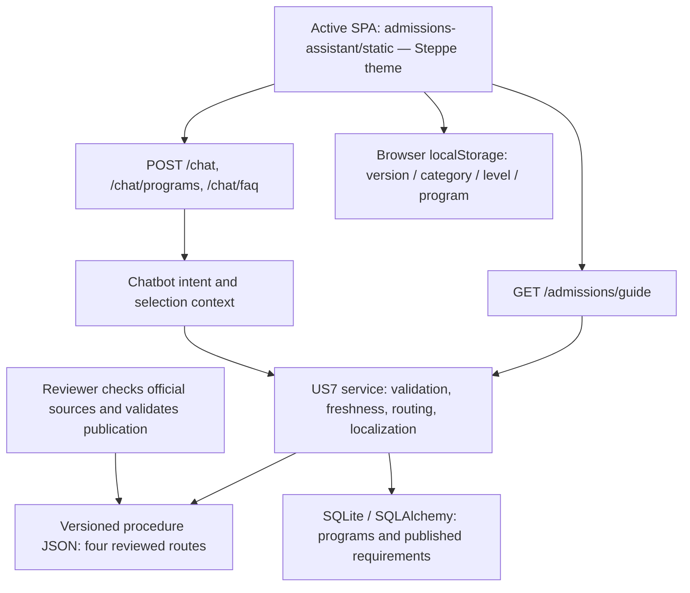

# Sprint 3 Final Report — Saken's Contribution

**Project:** Smart University Admissions Assistant<br>
**Assignee:** Saken Marat<br>
**Date:** October 18, 2026<br>
**Defense:** October 19, 2026<br>
**Repository:** [QazaKod/PM](https://github.com/QazaKod/PM)<br>
**Delivery branch:** `codex/sprint-3-saken-defense`<br>
**Automated tests:** 157 / 157 PASS

---

## 1. Sprint Overview and Scope

The goal of Saken's Sprint 3 work was to complete **US7 — Step-by-Step Admission Guide**: help applicants choose a program, understand the admission sequence, track their progress and check the official sources.

The existing FastAPI, SQLAlchemy and vanilla JavaScript architecture was retained. Authentication, applicant profiles, saved programs, chat history and earlier user stories remain integrated with the application. US7 works without a Gemini API key.

**Scope confirmation:** the Trello board was inspected in Safari. The only card in Doing assigned to Saken was [US7 — Step-by-Step Admission Guide](https://trello.com/c/OBJu9S2F/7-us-7-step-by-step-admission-guide-saken), due October 18, 2026. Its acceptance criteria cover ordered program/category steps, deadline warnings, EN/RU/KK, device-local progress, official sources, review dates, next-request updates and withholding stale data. The card was moved to **Done** and marked **Complete** after verification.

The User Story Schedule also assigns US7 to Saken. US9 belongs to Arman, US18 to Shadiyar and US19 to Yertai. This report covers Saken's contribution; it does not claim completion of the whole team's Sprint 3. No teammate messages were sent.

---

## 2. Completed User Story

### US7: Step-by-Step Admission Guide — 5 Story Points

> **As an applicant**, I want to receive a step-by-step guide to the admission procedure, so that I understand what actions I need to take.

**Program and applicant selection**

- Applicants can select a program, domestic/international category and Bachelor/Master level in the active Admission Guide interface.
- The service provides four distinct applicant routes, each available in English, Russian and Kazakh: **12 localized combinations**.
- The selected program is validated against the catalog and degree level. Published, current program-specific prerequisites are shown with their own source and verification date.
- The seeded catalog contains 14 Bachelor programs. Master currently provides a clearly labeled general route; Bachelor programs are not presented as verified Master offerings.

**Ordered instructions and progress**

- Each route displays stable step identifiers, sequential numbering, instructions and official source links.
- Checkboxes and a completion counter persist in the current browser, separately for each version, category, level and program. Changing the display language retains the same progress.
- A new procedure version starts separate progress. If browser storage is unavailable, progress remains in the current page session with an explicit warning.

**Deadlines and reviewed information**

- Published 2026 deadlines are labeled as a **closed admission cycle** after their date. The August 25 document deadline is explicitly limited to tuition-based admission.
- Unknown deadlines and unverified program conditions are referred to admissions rather than invented.
- Unsupported numerical thresholds, payment amounts and accommodation guarantees were removed from US7. It does not reuse the legacy calculators' figures.
- The guide shows its version, verification date and review deadline. Program conditions retain their separate verification date.

**One service for the interface, API and chatbot**

- The standalone guide and all three chat endpoints use the same admission guide service.
- “Ask in chat” transfers the selected program, applicant category, level and language.
- Invalid API selections return HTTP 422. Missing, malformed, unreviewed, future-dated or expired procedure publications return HTTP 503 without admission steps. The chatbot offers the admissions portal instead of substituting another route.
- Loading feedback, a 10-second client timeout, retry and protection against outdated parallel responses are implemented.

**Reviewed updates without restarting**

Procedure data is stored in `data/admission_procedures.json` and validated on every request. A reviewed replacement appears on the next UI/API/chat request without restarting the application. `scripts/validate_admission_guide.py` checks a candidate publication before it is deployed.

This implements the current Trello card's reviewed-publication workflow. It does not automatically scrape, approve or synchronize changes from the university website. Already displayed content updates when the applicant refreshes the guide or requests it again.

---

## 3. Before and After

| Area | Before | After |
| :--- | :--- | :--- |
| Applicant route | International Master could fall back to domestic Bachelor | Four independent routes; no silent substitution |
| Program selection | No program selector in the guide | Catalog selection, degree validation and reviewed prerequisites |
| Languages | Missing translations silently fell back to Russian | Complete EN/RU/KK route text; incomplete publications rejected |
| Progress | No guide progress tracking | Versioned, device-local checkboxes and counter |
| Information quality | Precise scores, fees and dates without freshness controls | Official links, review dates, closed-cycle warnings and withheld stale data |
| Updates | Procedure text embedded in Python | Validated JSON read on each request |
| Startup | Conflicting dependency pins; seed expected absent JSON files | Compatible SQLAdmin pin, explicit demo database and repeatable seed |

---

## 4. System Architecture



`app/main.py` serves `admissions-assistant/static/index.html` and mounts that directory at `/static`. `static/config.json` selects Steppe. The separate `theme-steppe/` directory is not served by this application.

Programs, FAQs, requirements, users, profiles and chat history are stored in SQLite. `DATABASE_URL` selects the database; `data/app.db` remains the default. US7 procedure JSON is read separately on each request. `LOG_FILE` controls both server logging and the authenticated admin log view.

Database initialization uses SQLAlchemy `create_all`; it is not a schema migration system. A separate demo database is seeded explicitly from the tracked legacy JSON backups. Tests use a disposable database selected before application import, and stub outbound AI and messaging services.

---

## 5. Test Results and Acceptance Criteria

The existing baseline had **103 passing tests** on an isolated seeded database. The final suite contains **157 passing tests**, including **54 new US7 acceptance and review checks**.

| Test module | Tests | Result | Coverage |
| :--- | ---: | :---: | :--- |
| `test_api.py` | 5 | PASS | Health, catalog, FAQ, root SPA and chat |
| `test_auth.py` | 17 | PASS | Registration, login, profile, favorites and local recovery flows |
| `test_chatbot.py` | 8 | PASS | Earlier program/FAQ matching and fallback behavior |
| `test_requirements.py` | 51 | PASS | US3 languages, clarification, publication and source checks |
| `test_admissions.py` | 22 | PASS | Existing Sprint 3 services, endpoints and chat integration |
| `test_guide_acceptance.py` | 48 | PASS | Routes, selections, deadlines, sources, expiry and live publication reload |
| `test_guide_review.py` | 6 | PASS | Program/category ambiguity and authenticated SQLAdmin compatibility |
| **Total** | **157** | **PASS** | **No failing automated checks** |

| Acceptance scenario | Actual verification | Result |
| :--- | :--- | :---: |
| Select a program and request its ordered guide | API tests and Computer Science in the real browser | PASS |
| Use EN/RU/KK and different applicant routes | All 12 API combinations; browser language/category changes | PASS |
| Warn about expired deadlines | Closed 2026 dates in UI/API/chat; deadline boundary tests | PASS |
| Save progress on the current device | Checkbox restored after reload and language change | PASS |
| Show official sources and review dates | API checks and visible source/date labels | PASS |
| Apply a reviewed update on the next request | File replacement tests for API/chat; browser retry on a separate policy copy | PASS |
| Withhold stale or invalid procedure data | HTTP 503, no steps, UI retry and chatbot admissions referral | PASS |

**Additional checks actually performed**

- `pip check`: no broken requirements; JavaScript syntax and `git diff --check` passed.
- Uvicorn was started with a separate demo database. Real `/programs`, `/admissions/guide` and `/chat` requests succeeded.
- Desktop 1280×900 and mobile 390×844 were inspected. At mobile size, the document and guide width were 390 pixels, with no horizontal overflow.
- The primary browser flow produced no JavaScript errors or warnings in the inspected console. The existing favicon request returned 404 without affecting the flow.
- On a separate test server, a two-second delay exposed the loading state. Expiring a copied policy caused a visible error and HTTP 503. Replacing it with a valid synthetic revision allowed retry to display the new revision without restart.
- During final review, a separate browser fixture blocked writes to guide storage. After checking a step and refreshing the guide, **1/6 progress remained**, with a warning that persistence lasts only until page reload.
- The final Python run emitted dependency/existing-code deprecation warnings; warnings are not counted as passed integrations.

Real Email/SMS/Telegram delivery and Gemini requests were not exercised. Messaging tests verify local logic with stubs, including the Telegram webhook, not external delivery.

---

## 6. Final Code Review

The entire delivery diff was reviewed: procedure data, service validation, API schemas, chat routing, active frontend, persistence, database configuration, seed script, dependencies, tests and documentation. Detailed findings are recorded in [Sprint 3 Review](sprint_3_review.md).

The review identified and fixed these additional defects:

1. **International program names changed applicant category.** Names such as International Law are now removed from category parsing before applying explicit category selection.
2. **Ambiguous program questions reused an earlier program.** A request naming multiple programs now asks the applicant to choose one.
3. **Blocked storage writes could discard in-session progress.** The page now keeps the current in-memory state when persistence fails.
4. **An outdated catalog response could overwrite a newer request's cached catalog.** Request identity is checked before assigning the result.
5. **The admin log page ignored `LOG_FILE`.** It now reads the configured log file; authenticated catalog and log rendering are covered by a regression test against SQLAdmin 0.20.1.
6. **Guide tests depended on the real date.** Functional tests now use the policy's review date while explicit expiry tests still check stale and future publications.

The original startup defects were also addressed: incompatible FastAPI/SQLAdmin pins, missing `itsdangerous`, missing `.json` seed inputs, repeated requirement inserts and import-time execution of the manual Gemini diagnostic.

---

## 7. Deliverables and Startup

**Implementation files:** `app/services/admission_guide.py`, `data/admission_procedures.json`, `app/chatbot.py`, `app/routers/admissions.py`, `app/schemas.py`, active HTML/JS/CSS, database/log configuration and admin log handling.

**Verification and setup:** acceptance/review tests, isolated fixtures, `pytest.ini`, compatible dependencies, demo seed and procedure validator. [README](../README.md) and [architecture](../architecture.md) describe the actual SQLite implementation.

For the already prepared local environment:

```bash
cd /Users/maratsaken/Documents/PM/admissions-assistant
export DATABASE_URL="sqlite:///$PWD/.demo/admissions.db"
export LOG_FILE="$PWD/.demo/app.log"
export TESTING=1
export GEMINI_API_KEY=""
.venv/bin/python -m uvicorn app.main:app --host 127.0.0.1 --port 8000
```

Open [the application](http://127.0.0.1:8000) or [API documentation](http://127.0.0.1:8000/docs). If the demo is already running on port 8000, do not start a second process. `TESTING=1` disables Telegram background polling; an empty Gemini key keeps the demonstration independent of external AI.

Full environment creation and safe demo seeding are documented in README. Never seed over a real user database. `.venv/`, `.demo/`, credentials, generated databases and runtime logs are excluded from the delivery. The original untracked `admissions-assistant-iteration1/` directory is preserved and excluded from the commit. The Safari screenshot containing unrelated browser tabs is retained locally as evidence rather than published.

Reproduce the checks from the application directory:

```bash
.venv/bin/python -m pytest -q
.venv/bin/python -m pip check
.venv/bin/python scripts/validate_admission_guide.py data/admission_procedures.json
node --check static/app.js
```

---

## 8. Defense Demonstration — 3–5 Minutes

1. **0:00–0:30 — Introduce the contribution.** “My Sprint 3 task is US7, the admission guide. The application uses FastAPI, SQLite and vanilla JavaScript. This feature works without Gemini.”
2. **0:30–1:20 — Show the applicant journey.** Open Admission Guide; select Domestic, Bachelor, Russian and Computer Science. Show the program's reviewed prerequisites, separate source dates, six ordered steps and closed 2026 deadline warnings.
3. **1:20–2:00 — Show progress.** Check a step, reload the page and reselect the same route/program. Explain that the restored progress belongs to the current browser and does not submit an application to SDU.
4. **2:00–2:40 — Switch languages and routes.** Select Kazakh and show the same progress. Then select English, International and Master. Explain the distinct route and the current general-Master limitation.
5. **2:40–3:20 — Show chat consistency.** Return to Domestic, Bachelor, Computer Science and click “Ask in chat.” Sample questions: `Admission guide for Computer Science undergraduate`; `Пошаговый гид поступления Computer Science`; `Computer Science қабылдау нұсқаулығы`.
6. **3:20–4:10 — Show verification.** Run pytest and show the tests for publication replacement and stale-data rejection. Explain that reviewers publish a validated version and the next request reads it. Do not modify the working catalog live just to demonstrate an error.
7. **4:10–4:40 — State limitations.** External delivery is unverified, Master has a general route, and the next review is due by November 1. Do not present the other contributors' legacy calculator outputs as verified fees or statistical grant probabilities.

**Short contribution statement:** “I completed the admission guide journey with program selection, separate applicant routes, three languages and saved progress. I unified the interface and chatbot responses, added official sources and deadline warnings, and made the service withhold expired procedure data. I also prepared isolated tests, reproducible setup instructions and the defense demonstration.”

---

## 9. Official Sources and Maintenance

Sources reviewed during preparation on October 18, 2026:

- [SDU Bachelor Admissions](https://sdu.edu.kz/en/admission-3-2/): general process, documents and the published 2026 grant/tuition-based deadlines.
- [SDU International Admissions](https://sdu.edu.kz/en/international-admissions/): international application, review and document guidance.
- [SDU Master Admissions](https://sdu.edu.kz/en/master/): general Master guidance; older dates on the page are not treated as current deadlines.
- [SDU Admissions Portal](https://admissions.sdu.edu.kz): official application portal.

This is sourced general guidance, not a personalized admission decision or a claim that university staff approved this software's full procedure. Program-specific conditions are displayed only when their publication metadata passes the existing freshness checks.

**Remaining maintenance and dependencies:**

- Review the procedure publication by **November 1, 2026**; after expiry, steps are withheld until a new reviewed publication is provided.
- Expand the catalog with verified Master programs before claiming program-specific Master support.
- Keep a reviewer-controlled publication process; automatic upstream synchronization and background updates of already open pages are not implemented.
- Verify external providers separately before demonstrating real messaging delivery.
- US18/US19 retain earlier contributors' legacy amounts, thresholds and heuristic grant labels. Their existing tests passing does not validate current real-world financial/admission accuracy.
- No schema migration framework was introduced. Use a separate demo database instead of modifying an existing user's schema.

The broader spreadsheet requested automatic updates when university policy changes. The current Trello criteria specify reviewed local updates appearing on the next request; this narrower, verifiable behavior is implemented. A full automated university-data integration remains future work.

---

## 10. Screenshots

**Desktop: program selection, source dates and progress**


**Mobile: international Master route at 390×844**


