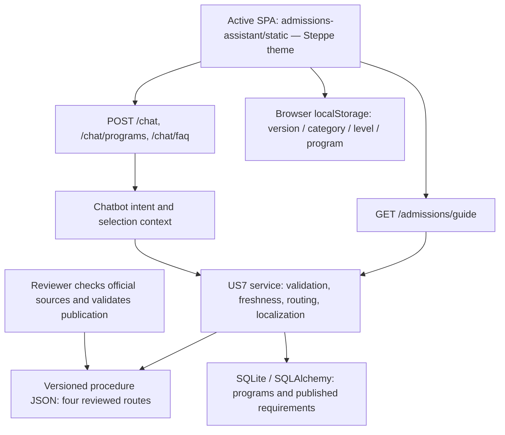
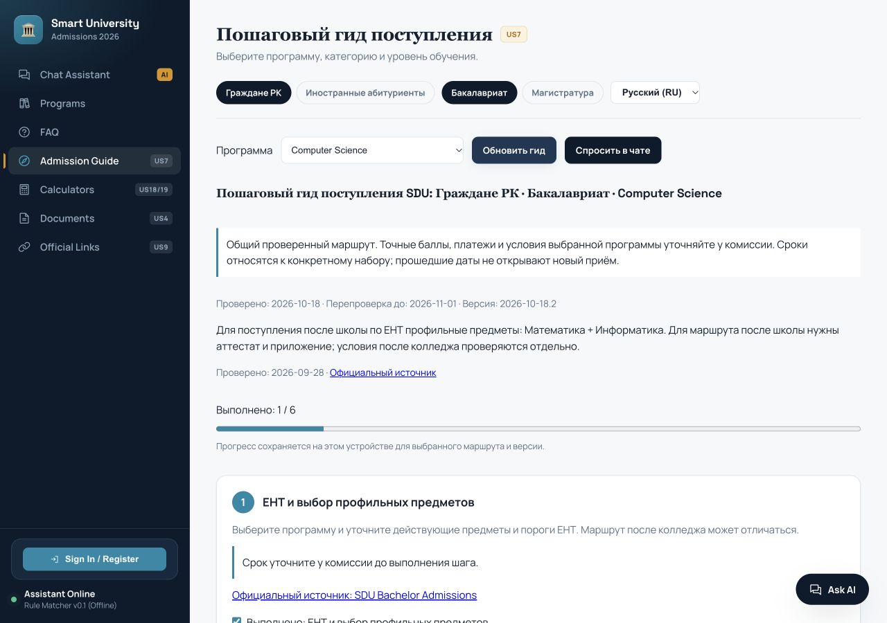
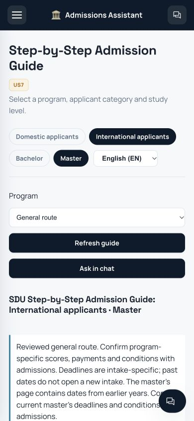

# Sprint 3 Final Report — Saken's Contribution

**Project:** Smart University Admissions Assistant<br>
**Assignee:** Saken Marat<br>
**Date:** October 18, 2026<br>
**Defense:** October 19, 2026<br>
**Repository:** [QazaKod/PM](https://github.com/QazaKod/PM)<br>
**Delivery branch:** `codex/sprint-3-saken-defense`<br>
**Audit verdict:** Ready for defense with limitations — audited final delivery<br>
**Previously published baseline tested:** `6f7cf57ef73f22fa7ab1300c6ea0e378a1cd955a`<br>
**Baseline suite:** 157 passed; **final delivery suite:** 168 passed, 49 warnings; both exit code 0

---

## 1. Sprint Overview and Scope

The goal of Saken's Sprint 3 work was to complete **US7 — Step-by-Step Admission Guide**: help applicants choose a program, understand the admission sequence, track their progress and check the official sources.

The existing FastAPI, SQLAlchemy and vanilla JavaScript architecture was retained. Authentication, applicant profiles, saved programs, chat history and earlier user stories remain integrated with the application. US7 works without a Gemini API key.

**Scope confirmation:** the Trello board was inspected in Safari. The card currently in Done and assigned to Saken is [US7 — Step-by-Step Admission Guide](https://trello.com/c/OBJu9S2F/7-us-7-step-by-step-admission-guide-saken), due October 18, 2026. Its acceptance criteria cover ordered program/category steps, deadline warnings, EN/RU/KK, device-local progress, official sources, review dates, next-request updates and withholding stale data. The card is marked **Done / Complete**. This final audit did not change its status. The previously published baseline still contained a blocking full-storage-denial defect despite that status. The corrections in this delivery supersede that baseline; the Trello status itself is not acceptance evidence.

The User Story Schedule also assigns US7 to Saken. US9 belongs to Arman, US18 to Shadiyar and US19 to Yertai. This report covers Saken's contribution; it does not claim completion of the whole team's Sprint 3. No teammate messages were sent.

---

## 2. Implemented US7 Scope and Limits

### US7: Step-by-Step Admission Guide — 5 Story Points

The behavior below describes the corrected final delivery. It must not be attributed in full to baseline commit `6f7cf57`, which passed its own suite but failed additional acceptance checks.

> **As an applicant**, I want to receive a step-by-step guide to the admission procedure, so that I understand what actions I need to take.

**Program and applicant selection**

- Applicants can select a program, domestic/international category and Bachelor/Master level in the active Admission Guide interface.
- The service provides four distinct applicant routes, each available in English, Russian and Kazakh: **12 localized combinations**.
- The selected program is validated against the catalog and degree level. Published, current program-specific prerequisites are shown with their own source and verification date.
- The seeded catalog contains 14 Bachelor programs. Master currently provides a clearly labeled general route; Bachelor programs are not presented as verified Master offerings.

**Ordered instructions and progress**

- Each route displays stable step identifiers, sequential numbering, instructions and official source links. General routes have six steps; selected teacher-education and journalism routes now add an entrance action before funding. International language assessment now precedes the interview, matching the source sequence.
- Checkboxes and a completion counter persist in the current browser, separately for each version, category, level and program. Changing the display language retains the same progress.
- A new procedure version starts separate progress. If browser storage is unavailable, progress remains in the current page session with an explicit warning.

**Deadlines and reviewed information**

- Published 2026 deadlines are labeled as a **closed admission cycle** after their date. The August 25 document deadline is explicitly limited to tuition-based admission. The international Bachelor route now labels the published fall dates as past and shows spring application/original-document dates with their intake scope; these dates are not assigned to the general Master route.
- Unknown deadlines and unverified program conditions are referred to admissions rather than invented.
- Unsupported numerical thresholds, payment amounts and accommodation guarantees were removed from US7. It does not reuse the legacy calculators' figures.
- The guide shows its version, verification date and review deadline. Program conditions retain their separate verification date.

**One service for the interface, API and chatbot**

- The standalone guide and all three chat endpoints use the same admission guide service.
- “Ask in chat” transfers the selected program, applicant category, level and language.
- Invalid API selections return HTTP 422. Missing, malformed, unreviewed, future-dated or expired procedure publications return HTTP 503 without admission steps. The chatbot offers the admissions portal instead of substituting another route.
- Loading feedback, a 10-second client timeout, retry and protection against outdated parallel responses are implemented.

**Reviewed updates without restarting**

Procedure data is stored in `data/admission_procedures.json` and validated on every request. A reviewed replacement appears on the next UI/API/chat request without restarting the application. `scripts/validate_admission_guide.py` checks a candidate publication before it is deployed.

This implements the current Trello card's reviewed-publication workflow. It does not automatically scrape, approve or synchronize changes from the university website. Already displayed content updates when the applicant refreshes the guide or requests it again.

---

## 3. Before and After

| Area | Before | After |
| :--- | :--- | :--- |
| Applicant route | International Master could fall back to domestic Bachelor | Four independent routes; no silent substitution |
| Program selection | No program selector in the guide | Catalog selection, degree validation and reviewed prerequisites |
| Languages | Missing translations silently fell back to Russian | Complete EN/RU/KK route text; incomplete publications rejected |
| Progress | No guide progress tracking | Versioned, device-local checkboxes and counter |
| Information quality | Precise scores, fees and dates without freshness controls | Official links, review dates, closed-cycle warnings and withheld stale data |
| Updates | Procedure text embedded in Python | Validated JSON read on each request |
| Startup | Conflicting dependency pins; seed expected absent JSON files | Compatible SQLAdmin pin, explicit demo database and repeatable seed |

---

## 4. System Architecture



`app/main.py` serves `admissions-assistant/static/index.html` and mounts that directory at `/static`. `static/config.json` selects Steppe. The separate `theme-steppe/` directory is not served by this application.

Programs, FAQs, requirements, users, profiles and chat history are stored in SQLite. `DATABASE_URL` selects the database; `data/app.db` remains the default. US7 procedure JSON is read separately on each request. `LOG_FILE` controls both server logging and the authenticated admin log view.

Database initialization uses SQLAlchemy `create_all`; it is not a schema migration system. A separate demo database is seeded explicitly from the tracked legacy JSON backups. Tests use a disposable database selected before application import, and stub outbound AI and messaging services.

---

## 5. Independent Final Acceptance Results

A clean source archive of commit `6f7cf57ef73f22fa7ab1300c6ea0e378a1cd955a` was extracted into a new temporary directory. A new Python 3.12 virtual environment was created and dependencies installed using README. No prepared workspace environment or user database was used. Demo seeding exited 0; the documented Uvicorn startup was exercised on the free audit port 8010.

**Actual commands and results**

| Check | Command from the isolated application directory | Result |
| --- | --- | --- |
| Clean installation | `.venv/bin/python -m pip install -r requirements.txt` | Exit 0; yanked-SDK warning described below |
| Clean demo seed | `DATABASE_URL=sqlite:///.../.demo/admissions.db .venv/bin/python scripts/migrate_to_sqlite.py --demo` | Exit 0 |
| Unmodified published suite | `.venv/bin/python -m pytest -q -ra` | Exit 0; **157 passed, 49 warnings, 6.09 s** |
| Corrected suite in isolated audit environment | `.venv/bin/python -m pytest -q -ra` | Exit 0; **168 passed, 49 warnings, 5.94 s** |
| Finalization rerun on the exact final source and documentation tree | `.venv/bin/python -m pytest -q -ra` | Exit 0; **168 passed, 49 warnings**, no failures or skips |
| Dependencies | `.venv/bin/python -m pip check` | Exit 0; no broken requirements |
| Policy validation | `.venv/bin/python scripts/validate_admission_guide.py data/admission_procedures.json` | Exit 0; version `2026-10-18.2`, four general routes |
| JavaScript | `node --check static/app.js` | Exit 0 |
| Whitespace | `git diff --check origin/main...HEAD` and `git diff --check` | Exit 0 |

There were no pytest failures or skips in the baseline, corrected audit or finalization runs. The 49 warnings concern deprecated `datetime.utcnow()` and Starlette/multipart and AnyIO compatibility APIs; they do not establish external integration success. Installation also warned that the pre-existing `google-genai==0.5.0` release is yanked, citing Pillow vulnerability issues. That optional SDK remains pinned; production dependency security is not certified by this audit.

Tests freeze the guide review date for repeatability and stub outbound AI/messaging. These are appropriate isolation boundaries, but they do not prove real-time source accuracy or provider delivery. Some existing authentication tests share ordered setup state. The audit therefore also ran separate real HTTP checks with the actual service clock and no guide-service mocks: **32 checks passed after correction**, plus **12 authentication/profile/catalog/FAQ/chat regression checks** with outbound sockets blocked. The unmodified commit had failed the whitespace-only-publication check even though its 157 tests passed.

| Requirement | Implementation | Automated / HTTP evidence | Browser evidence | Result for final corrections |
| --- | --- | --- | --- | --- |
| Ordered guide for selected program/category | Guide service, procedure JSON, admissions router | Route/program checks; special exam ordering tests | Computer Science prerequisites; teacher-education extra step | PASS for supported general/Bachelor routes |
| Deadline warnings and closed 2026 cycle | Procedure JSON and guide service | Boundary and scoped-deadline checks | Past domestic dates; scoped international guidance | PASS |
| RU / KK / EN | Procedure text and active frontend | Twelve API combinations | All twelve UI combinations inspected | PASS |
| Device-local progress | Active `static/app.js` | Source/key review | Reload; language; program/category/level/version separation | PASS when storage is available |
| Graceful storage denial | Safe storage initialization and guide fallback | Changed code inspected | Denied reads and denied writes; session progress and warning | PASS in final delivery; FAIL in baseline `6f7cf57` |
| Official links and review metadata | Guide/requirements publication checks | Source/date validation | Visible links and distinct review dates | PASS for provenance display |
| Complete, currently approved program procedure | General guidance and limited catalog | Metadata cannot prove this | General Master limitation and legacy labels visible | UNVERIFIED |
| Reviewed local update without restart | Per-request catalog loading | Live API/chat replacement | New revision after retry; version-specific progress | PASS |
| Withhold invalid/stale data | Catalog schema and freshness gate | Missing/malformed/future/draft/expired/empty/blank checks | Expired policy hidden, retry recovers | PASS in final delivery |
| Automatic upstream university synchronization (spreadsheet) | Not implemented | No synchronizer exists | Manual local replacement only | FAIL against broader spreadsheet wording |
| Clean startup and earlier features | Setup/seed/config; existing modules | Clean install; full suite; 12 real HTTP regressions | Actual active Steppe frontend, catalog and FAQ | PASS for local demonstration |

**Browser checks performed in this audit:** isolated ports 8010/8011; program prerequisites; twelve route/language combinations; progress after reload and language changes; separation across program, category, level and publication version; full read denial and write denial; guide-to-chat transfer of International/Bachelor/Computer Science/Kazakh; loading, the client timeout, retry, a delayed old response not replacing the latest category, and expired-data replacement without restarting. Desktop 1280×900 and mobile 390×844 were inspected; document width equaled viewport width. The inspected normal-flow console had no errors or warnings. The original full-storage-denial run had SecurityError and guide-initialization ReferenceError, which were reproduced before fixing. The existing favicon 404 is a nonblocking resource failure; intentional 503/abort requests belong to negative tests.

Source files and policy copies used for failure injection were isolated from the working demo. Copies/configuration were restored and auxiliary servers were stopped after checks. Real provider delivery and Gemini calls remain UNVERIFIED.

---

## 6. Final Audit Findings and Corrections

The whole delivery diff against main was inspected, including backend, all procedure routes/translations, chatbot, active frontend, setup/dependencies, tests and documentation. The final audit found gaps that the earlier review had not covered:

1. **Blocking: complete storage-read denial aborted page initialization.** The earlier document-checklist read threw before guide variables/handlers were initialized. Only write denial had previously been tested. Existing storage consumers now use a guarded session fallback; the guide still reports when durable persistence is unavailable. Both denial modes were rechecked in the real browser, including preservation of the warning after refresh.
2. **Whitespace-only translations were accepted as reviewed content.** Publication strings are now stripped before non-empty validation; such content returns 503 and is withheld from chat.
3. **Program-specific entrance actions were missing.** The teacher-education route now contains a special exam action; journalism has a creative-route/current-program confirmation before funding. Unknown dates are not invented.
4. **The international route put language confirmation after the interview.** Its assessment/certificate step now precedes the coordinator interview, following the official page. Published spring Bachelor dates are scoped separately from closed fall dates; Master dates remain unconfirmed.
5. **Expiry tests could fail schema validation before reaching the freshness gate.** New checks use well-formed but genuinely expired/future publications and verify the freshness-specific response.

The previously reviewed branch fixes for International Law category parsing, ambiguous program questions, in-memory progress, stale catalog responses, admin logs and date-stable functional tests remain in place and passed the rerun. See [the review correction](sprint_3_review.md) and [the Russian final acceptance audit](sprint_3_acceptance_audit.md).

These corrections and documentation updates are reviewed changes over baseline `6f7cf57`. The independent audit made no publication changes. Finalization reruns the suite and dependency, policy, JavaScript and whitespace checks on the final tree, then publishes a separate fast-forward commit to `codex/sprint-3-saken-defense`. The exact final commit is identified by Git history and the final delivery response. No force-push or merge into main is part of this delivery. A passing corrected tree does not retroactively make the unchanged baseline pass acceptance.

---

## 7. Deliverables and Startup

**Implementation files:** `app/services/admission_guide.py`, `data/admission_procedures.json`, `app/chatbot.py`, `app/routers/admissions.py`, `app/schemas.py`, active HTML/JS/CSS, database/log configuration and admin log handling.

**Verification and setup:** acceptance/review tests, isolated fixtures, `pytest.ini`, compatible dependencies, demo seed and procedure validator. [README](../README.md) and [architecture](../architecture.md) describe the actual SQLite implementation.

For the already prepared local environment:

```bash
cd /Users/maratsaken/Documents/PM/admissions-assistant
export DATABASE_URL="sqlite:///$PWD/.demo/admissions.db"
export LOG_FILE="$PWD/.demo/app.log"
export TESTING=1
export GEMINI_API_KEY=""
unset ADMISSION_GUIDE_FILE
.venv/bin/python -m uvicorn app.main:app --host 127.0.0.1 --port 8000
```

Open [the application](http://127.0.0.1:8000) or [API documentation](http://127.0.0.1:8000/docs). If the demo is already running on port 8000, do not start a second process. `TESTING=1` disables Telegram background polling; an empty Gemini key keeps the demonstration independent of external AI.

Full environment creation and safe demo seeding are documented in README. Never seed over a real user database. `.venv/`, `.demo/`, credentials, generated databases and runtime logs are excluded from the delivery. The original untracked `admissions-assistant-iteration1/` directory is preserved and excluded from the commit. The Safari screenshot containing unrelated browser tabs remains local; it is not used as acceptance proof. First-time setup, subsequent startup, alternate-port and Control+C instructions are separate in README.

Reproduce the checks from the application directory:

```bash
.venv/bin/python -m pytest -q
.venv/bin/python -m pip check
.venv/bin/python scripts/validate_admission_guide.py data/admission_procedures.json
node --check static/app.js
```

---

## 8. Defense Demonstration — 3–5 Minutes

1. **0:00–0:30 — Introduce the contribution.** “My Sprint 3 task is US7, the admission guide. The application uses FastAPI, SQLite and vanilla JavaScript. This feature works without Gemini.”
2. **0:30–1:20 — Show the applicant journey.** Open Admission Guide; select Domestic, Bachelor, Russian and Computer Science. Show the program's reviewed prerequisites, separate source dates, the ordered steps and closed 2026 deadline warnings. For the extra program action, also select Two Foreign Languages.
3. **1:20–2:00 — Show progress.** Check a step, reload the page and reselect the same route/program. Explain that the restored progress belongs to the current browser and does not submit an application to SDU.
4. **2:00–2:40 — Switch languages and routes.** Select Kazakh and show the same progress. Then select English, International and Master. Explain the distinct route and the current general-Master limitation.
5. **2:40–3:20 — Show chat consistency.** Return to Domestic, Bachelor, Computer Science and click “Ask in chat.” Sample questions: `Admission guide for Computer Science undergraduate`; `Пошаговый гид поступления Computer Science`; `Computer Science қабылдау нұсқаулығы`.
6. **3:20–4:10 — Show verification.** Run pytest: the final corrected suite has 168 tests. Show publication replacement, real expiry and whitespace rejection tests. Explain that reviewers publish a validated version and the next request reads it. Do not modify the working catalog live just to demonstrate an error.
7. **4:10–4:40 — State limitations.** External delivery is unverified, Master has a general route, and the next review is due by November 1. Do not present the other contributors' legacy calculator outputs as verified fees or statistical grant probabilities.

**Short contribution statement:** “I implemented the admission guide journey with program selection, separate applicant routes, three languages and saved progress. I unified the interface and chatbot responses, added official sources and deadline warnings, and made the service withhold expired procedure data. I also prepared isolated tests, reproducible setup instructions and the defense demonstration.”

---

## 9. Official Sources and Maintenance

Sources reviewed during preparation on October 18, 2026:

- [SDU Bachelor Admissions](https://sdu.edu.kz/en/admission-3-2/): general process, documents and the published 2026 grant/tuition-based deadlines.
- [SDU International Admissions](https://sdu.edu.kz/en/international-admissions/): international application, review and document guidance.
- [SDU Master Admissions](https://sdu.edu.kz/en/master/): general Master guidance; older dates on the page are not treated as current deadlines.
- [SDU Admissions Portal](https://admissions.sdu.edu.kz): official application portal.

This is sourced general guidance, not a personalized admission decision or a claim that university staff approved this software's full procedure. Program-specific conditions are displayed only when their publication metadata passes the existing freshness checks.

**Remaining maintenance and dependencies:**

- Review the procedure publication by **November 1, 2026**; after expiry, steps are withheld until a new reviewed publication is provided.
- Expand the catalog with verified Master programs before claiming program-specific Master support.
- Keep a reviewer-controlled publication process; automatic upstream synchronization and background updates of already open pages are not implemented.
- Verify external providers separately before demonstrating real messaging delivery.
- US18/US19 retain earlier contributors' legacy amounts, thresholds and heuristic grant labels. Their existing tests passing does not validate current real-world financial/admission accuracy.
- No schema migration framework was introduced. Use a separate demo database instead of modifying an existing user's schema.

**Unresolved source conflicts:** the spreadsheet requires automatic updates when university procedure changes; the Trello card requires next-request loading of reviewed local updates. Only the latter is implemented. Backlog gives US9 an October 25 deadline whereas the spreadsheet gives October 18 and adds US18/US19 to Sprint 3. The card still mentions `feat/sprint-3`, while the actual delivery branch is `codex/sprint-3-saken-defense`. These inconsistencies were recorded, not silently resolved or edited in Trello.

---

## 10. Screenshots

**Desktop: program selection, source dates and progress — final audit capture**



**Mobile: general international Master route at 390×844 — final audit capture**


