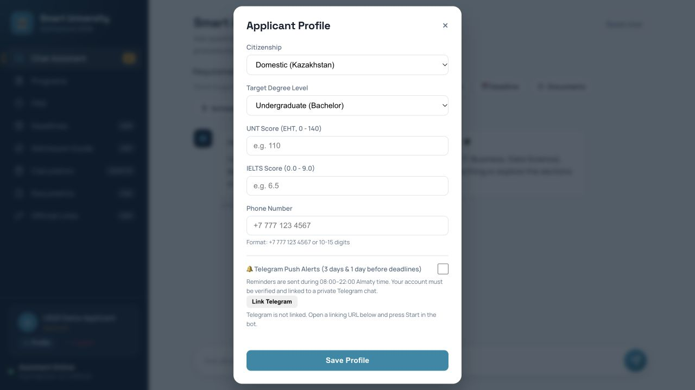

# Sprint 4 — US20 Telegram Push Alerts (Saken)

Implementation date: November 2, 2026. Deadline: November 8, 2026.

## Scope and contribution

The incoming `main` already contained a manual alert endpoint, an opt-out field,
profile checkbox, Telegram transport and US8 calendar. This delivery completes
the scheduled execution path, durable deduplication, authenticated private-chat
linking, webhook authentication, checklist button and regression coverage.

- The worker checks the existing US8 calendar every minute for milestones opening
  or closing in **3 and 1 calendar days**, in `Asia/Almaty` (UTC+5).
- Automatic runs respect quiet hours **22:00–08:00**. A restart can catch up during
  the same eligible day; missed previous days are not replayed.
- Only active, verified **applicant** accounts with notifications enabled and a
  new verified private-chat binding receive reminders. Legacy `telegram_chat_id`
  values alone do not qualify. Account verification and Telegram ownership are
  separate checks.
- In Profile, click **Link Telegram**, open the generated URL and press **Start**.
  The authenticated link expires in 15 minutes, is hashed in storage, single-use,
  and can only be consumed in a private chat. A chat cannot bind to two accounts.
  Reopen Profile to see link status. The notification toggle persists opt-out.
- Telegram messages escape HTML and include an inline button to the application
  admission checklist (`PUBLIC_APP_URL/#guide`), plus the calendar's action URL.
- A database primary key claims each `(chat, milestone, event date, opening/closing,
  offset)` before delivery. Manual triggers share the same ledger. Repeated runs,
  restart and concurrent workers do not resend that claim. An opt-out never resets
  delivery history. A changed event date is a new reminder.
- Webhook calls must provide `X-Telegram-Bot-Api-Secret-Token`; configure Telegram
  with the matching `TELEGRAM_WEBHOOK_SECRET`. Polling does not need a webhook.

## Run and configuration

From `admissions-assistant`, configure the same `DATABASE_URL`, bot token and
username for the web application and worker. Keep secrets in the local environment,
never in Git. `PUBLIC_APP_URL` must be an HTTPS application origin reachable from
an applicant's phone. A localhost URL is not a usable Telegram checklist target.

```bash
.venv/bin/python -m pip install -r requirements.txt
.venv/bin/python -m alembic upgrade head
# Start web in a separate terminal. For a separate polling worker:
export TELEGRAM_MODE=worker_disabled
.venv/bin/python -m uvicorn app.main:app --host 127.0.0.1 --port 8000
# Worker terminal, using the same environment/database:
.venv/bin/python -m scripts.run_telegram_bot
```

The standalone worker starts both polling and reminders. Alternatively, for a
single-process web deployment set `TELEGRAM_REMINDERS_ENABLED=true`; do not also
start a separate poller. Docker's existing `telegram_worker` invokes this combined
worker and now passes `PUBLIC_APP_URL`. The repository has no Dockerfile, so the
pre-existing Compose build remains unavailable until a deployment image is supplied;
Docker/PostgreSQL deployment is not certified by this delivery.

A cron alternative for reminders (use absolute paths, configured environment and
one shared persistent DB) can call `run_reminder_cycle()` every minute:

```bash
.venv/bin/python -c 'from app.services.telegram_notifications import run_reminder_cycle; print(run_reminder_cycle())'
```

Missing token or invalid/missing HTTPS application URL results in no dispatch and
no delivery claims. `TESTING=1` disables web background jobs. Tests use isolated
SQLite and mocked external sends; never use production recipients for tests.

Staff can still use `POST /deadlines/trigger-alerts?days_ahead=3` or `1`.
`force_send=true` overrides quiet hours for staff only; it cannot bypass eligibility
or deduplication. Do not use it with real recipients for demonstration.

## Delivery semantics and remaining requirements

- The source calendar contains dates, not timestamped cutoff times. This supports
  the user story's 3-day/1-day reminders and daily-scheduler QA scenario, but the
  separate spreadsheet wording **exactly 72 hours** is **not proven/implemented**.
  Official cutoff timestamps are required before that can be promised.
- Telegram has no application-supplied idempotency key for `sendMessage`. If a
  request times out or a process crashes after claiming, delivery can be uncertain.
  `uncertain` and abandoned `claimed` rows are not retried automatically: this
  favors avoiding duplicate applicant messages over guaranteeing delivery.
  Operators must inspect such rows/provider evidence before any manual recovery.
  Definite rejected sends also need operator recovery; no automatic retry queue is
  claimed. Do not delete claims merely to make a demo send again.
- Automated upstream university-policy/calendar/checklist synchronization remains
  **unimplemented**. The “Verified” label in spreadsheet maintenance row A25 is
  not evidence of a running synchronizer. This worker consumes the existing
  manually maintained US8 calendar, whose real-world accuracy is not re-certified
  here. Historical 2026 dates are not rolled into another campaign.
- The US7 review period ended November 1: the existing freshness gate intentionally
  withholds expired procedure content until independently reviewed. This delivery
  does not extend review dates or claim the checklist data is current. Master
  remains a general route; full program-specific procedures remain unverified.
- No real Telegram recipient message, production deployment, high-volume throughput
  or PostgreSQL concurrency check was performed. The 15-minute high-volume batch
  threshold remains unverified. A configured, running worker and reachable public
  application are deployment prerequisites.

## Validation

- Baseline after updating from `origin/main` (`1c7cb7b`): **201 passed, 116 warnings**.
- Final full suite: **220 passed**, exit 0, no failures or skips (external sends mocked).
- `pip install -r requirements.txt`, `pip check`, `node --check static/app.js`
  and `git diff --check`: exit 0.
- `alembic upgrade head` on a new isolated SQLite database and a second repeat
  upgrade: exit 0; revision `002_deadline_alerts` and both new tables verified.
- Browser on isolated port 8010: authenticated synthetic applicant, visible private
  Telegram link status, preference disabled and preserved after reopening Profile,
  one-use URL issuance without opening Telegram. No external recipient was messaged.
- Local demo on port 8000: `/health` returns `ok`, Telegram delivery disabled.
- The suite emits existing and added `datetime.utcnow()` deprecation warnings,
  plus Starlette/AnyIO compatibility warnings. They do not prove provider delivery
  or production readiness.
New coverage includes real SQLite ledger persistence, concurrent claims, UTC/Almaty
quiet-hour boundaries, separate offsets, eligibility, opt-out, private linking,
expiry/replay, duplicate-chat rejection, webhook authentication, escaped HTML,
actual inline-keyboard payload, provider `ok` handling, unconfigured operation and
one automatic scheduler cycle. External Telegram sends are mocked.

References: [Telegram Bot API](https://core.telegram.org/bots/api#sendmessage),
[deep linking](https://core.telegram.org/bots/features#deep-linking),
[webhook secret](https://core.telegram.org/bots/api#setwebhook).



