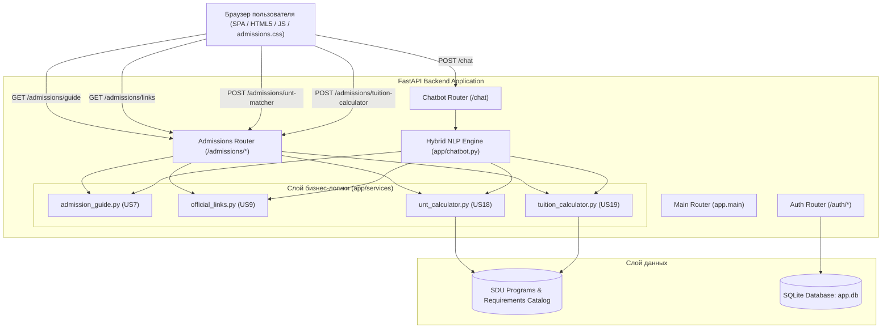

> **Примечание интеграции, 19 октября 2026:** ниже сохранён исходный командный отчёт до финальной приёмки US7. Его результаты 103 тестов и заявления о полноте — исторические, а не итоговый статус. Актуальные результаты и ограничения: [English US7 report](docs/sprint_3_report.md) и [приёмочный аудит](docs/sprint_3_acceptance_audit.md). Автоматическая синхронизация данных университета не реализована; Master остаётся общим маршрутом.

# Отчёт по Sprint 3 (Итерация 3)
**Проект:** Smart University Admissions Assistant (Интеллектуальный портал приёмной комиссии SDU)  
**Команда:** Arman, Saken, Shadiyar, Yertai, Collaborators  
**Период выполнения:** 12 октября – 25 октября 2026  
**Репозиторий:** [GitHub: QazaKod/PM](https://github.com/QazaKod/PM)  
**Статус автоматических тестов:** 103 / 103 PASS (100%)  
**Результат сборки Frontend:** Node.js syntax check — 0 errors  

---

## 1. Цели и скоуп Спринта 3 (Sprint Goal)

Основная цель Спринта 3 — **предоставление абитуриентам интерактивных инструментов академической и финансовой навигации**:
1. Разработка сервиса **пошагового руководства по поступлению** (US7) с локализацией на 3 языка (RU, KK, EN) и сегментацией по категориям абитуриентов (граждане РК и иностранные граждане, бакалавриат и магистратура).
2. Формирование каталога **официальных проверенных источников и каналов связи** (US9) для безопасной верификации информации (порталы SDU, НЦТ, eGov, олимпиада SPT, WhatsApp, Telegram, общежития).
3. Создание интеллектуального **калькулятора соответствия баллам ЕНТ** (US18) с поддержкой нечеткого сопоставления профильных предметов, проверки пороговых баллов SDU (50/65/75) и выделения программ с нехваткой баллов (`points_needed`).
4. Внедрение **финансового калькулятора стоимости обучения и грантов** (US19): расчет 4-летней стоимости, скидок SDU («Алтын белгі» 15%, ЕНТ 110+ 20–30%, скидка для братьев и сестер 10%, олимпиада SPT 30% с капом до 50%), графика платежей 50/50, сбора первокурсника (60 000 ₸) и прогноза шансов на государственный образовательный грант РК.
5. Интеграция всех сервисов в **единый чат-бот** с сохранением 100% обратной совместимости с US1 (программы), US3 (проверенные требования) и US5 (FAQ).
6. Реализация **полноценного интерфейса SPA** с динамической сменой вкладок, интерактивными формами и отдельным модулем стилей `admissions.css`.
7. Автоматизированное тестирование: написание 22 новых интеграционных тестов с расширением тестового набора до **103 тестов**.

---

## 2. Реализованные User Stories

### 🗺️ US7: Step-by-Step Admission Guide (Пошаговый гид поступления)
* **Story Points:** 5 | **Ответственный:** Saken | **Тесты:** `US7QATest`
* **Описание:** Как абитуриент, я хочу получить пошаговую инструкцию по процедуре поступления, чтобы четко понимать последовательность действий от сдачи ЕНТ до заселения в общежитие.
* **Реализация в Backend:**
  - Создан сервис `app/services/admission_guide.py` с функцией `get_admission_guide(category, level, lang)`.
  - Маршрут разбит на 6 ключевых этапов:
    1. *Этап 1:* Сдача ЕНТ и выбор профильных предметов (пороговые баллы SDU 50/65/75, не менее 5 баллов по каждому предмету).
    2. *Этап 2:* Подача заявления на Республиканский конкурс госгрантов РК (13–20 июля через eGov) или участие в олимпиаде SDU SPT (скидки до 100%).
    3. *Этап 3:* Онлайн (admissions.sdu.edu.kz) или очная подача документов в кампус SDU (аттестат, сертификат ЕНТ, удостоверение личности, медсправка 075-У, карта прививок 063-У, 6 фото 3х4).
    4. *Этап 4:* Подтверждение уровня английского языка (IELTS 5.5+, TOEFL iBT 46+ или внутренний тест SDU Proficiency Exam B1+ / курс Foundation).
    5. *Этап 5:* Подписание договора и оплата первого семестрового взноса (50%) + обязательный разовый сбор первокурсника (60 000 KZT).
    6. *Этап 6:* Подача заявки на общежитие и регистрация на учебные дисциплины (20–42 ECTS) через Portal SDU.
  - Поддержка трех языков (**RU**, **KK/KZ**, **EN**) и двух категорий поступающих (**Domestic** vs. **International**). Для иностранных студентов ЕНТ заменяется визовой поддержкой и нострификацией документов.
* **API Эндпоинт:** `GET /admissions/guide?category=domestic&level=undergraduate&lang=ru`.

---

### 🔗 US9: Official Source Links (Официальные проверенные ссылки)
* **Story Points:** 2 | **Ответственный:** Arman | **Тесты:** `US9QATest`
* **Описание:** Как абитуриент, я хочу получать ссылки на официальные университетские и государственные порталы, чтобы самостоятельно проверять достоверность информации и не стать жертвой мошенников.
* **Реализация в Backend:**
  - Создан сервис `app/services/official_links.py` с функцией `get_official_links()`.
  - В реестр включены 8 верифицированных источников:
    - `sdu_portal`: Официальный сайт SDU University (`https://sdu.edu.kz`)
    - `admissions_portal`: Портал приемной комиссии (`https://admissions.sdu.edu.kz`)
    - `testcenter`: Национальный центр тестирования РК (`https://testcenter.kz`)
    - `egov`: Электронное правительство РК / Госгранты (`https://egov.kz`)
    - `sdu_spt`: Республиканская олимпиада SDU SPT (`https://spt.sdu.edu.kz`)
    - `whatsapp_admissions`: Официальный WhatsApp приемной комиссии (`https://wa.me/77020001133`)
    - `telegram_bot`: Telegram-бот регистрации и оповещений (`https://t.me/sdu_admissions_registration_bot`)
    - `dormitory`: Информация о студенческих общежитиях (`https://sdu.edu.kz/dormitory`)
  - Прямые каналы связи: телефон горячей линии `+7 (727) 307-95-65` и email `admission@sdu.edu.kz`.
* **API Эндпоинт:** `GET /admissions/links`.

---

### 🎯 US18: UNT Eligibility Matcher (Подбор программ по баллам ЕНТ)
* **Story Points:** 5 | **Ответственный:** Shadiyar | **Тесты:** `US18QATest`
* **Описание:** Как абитуриент, я хочу ввести свои два профильных предмета ЕНТ и общий балл, чтобы моментально узнать, на какие специальности SDU я прохожу по пороговым баллам.
* **Реализация в Backend:**
  - Создан сервис `app/services/unt_calculator.py` с функцией `match_unt_eligibility(subject_1, subject_2, score)`.
  - Двунаправленная мультиязычная нормализация названий предметов (RU, KZ, EN) через регулярные выражения (Mathematics, Computer Science, Physics, Geography, World History, Fundamentals of Law, Foreign Language, Creative Exams, Biology, Chemistry).
  - Валидация пороговых баллов SDU:
    - Общий порог для бизнес-направлений и MCM: **50 баллов**
    - Педагогические и социальные науки (Два языка, Перевод, МО): **65 баллов**
    - Юриспруденция и IT-направления (CS, IS, SE, Law): **75 баллов**
    - По каждому предмету ЕНТ — не менее 5 баллов.
  - Сопоставление профильных комбинаций предметов:
    - *Математика + Информатика* → Computer Science, Information Systems, Software Engineering
    - *Математика + Физика* → Mathematical and Computer Modeling (MCM)
    - *Математика + География* → Finance, Accounting and Audit, Management, Marketing
    - *Всемирная история + Основы права* → Jurisprudence (Law)
    - *Иностранный язык + Всемирная история* → Translation Studies, Two Foreign Languages, International Relations
  - Формирование ответа: список доступных программ (`eligible_programs`), список программ с нехваткой баллов (`deficit_programs` с указанием `points_needed`), расчет профицита баллов (`points_surplus`) и шанса на государственный грант.
* **API Эндпоинт:** `POST /admissions/unt-matcher`.

---

### 💰 US19: Tuition & Grant Calculator (Калькулятор стоимости обучения и скидок)
* **Story Points:** 5 | **Ответственный:** Yertai | **Тесты:** `US19QATest`
* **Описание:** Как абитуриент, я хочу рассчитать точную стоимость обучения с учетом моих индивидуальных скидок и баллов ЕНТ, узнать график семестровых платежей и оценить вероятность получения государственного гранта.
* **Реализация в Backend:**
  - Создан сервис `app/services/tuition_calculator.py` с функцией `calculate_tuition_and_grant(program_id, unt_score, discounts)`.
  - Получение базовой стоимости программы из каталога (от 1 550 000 до 1 850 000 KZT/год) и расчет 4-летнего цикла обучения.
  - Реализация правил университетских скидок:
    - `altyn_belgi`: **15% скидка** для обладателей знака «Алтын белгі»
    - `high_unt`: **20% скидка** при 110–119 баллах ЕНТ, **30% скидка** при 120+ баллах ЕНТ
    - `sibling`: **10% семейная скидка** при одновременном обучении двух и более детей из одной семьи
    - `spt_winner`: **30% скидка** для призеров Республиканской олимпиады SDU SPT
    - Ограничение (Cap): суммарная университетская скидка **не может превышать 50%**.
  - График платежей (50/50 Semester Schedule):
    - Семестр 1: 50% годовой суммы при заключении договора
    - Разовый обязательный сбор первокурсника: **60 000 KZT**
    - Итоговый первый взнос: Семестр 1 + 60 000 KZT
    - Семестр 2: 50% до начала весеннего семестра
  - Прогнозирование шансов на государственный образовательный грант РК по историческим проходным баллам:
    - IT-направления (проходной ~115): `>= 115` → **HIGH**, `100–114` → **MEDIUM**, `< 100` → **LOW**
    - Бизнес-направления (проходной ~105): `>= 105` → **HIGH**, `90–104` → **MEDIUM**, `< 90` → **LOW**
    - Право и гуманитарные науки (проходной ~110): `>= 110` → **HIGH**, `95–109` → **MEDIUM**, `< 95` → **LOW**
* **API Эндпоинт:** `POST /admissions/tuition-calculator`.

---

## 3. Чат-бот и NLP интеграция (`app/chatbot.py`)

Все сервисы Спринта 3 бесшовно интегрированы в интеллектуальный маршрутизатор чат-бота:
* **Вопросы по этапам поступления:** Запросы вроде *"Как поступить в SDU?"*, *"Каковы шаги поступления?"* распознаются и возвращают упорядоченный список этапов поступления с прямой ссылкой на портал (`source="admission_guide"`).
* **Вопросы по официальным ссылкам:** Запросы вроде *"Официальный сайт"*, *"Где сайт ЕНТ?"*, *"Дай ссылки SDU"* возвращают проверенные адреса порталов (`source="official_links"`).
* **Вопросы по баллам ЕНТ:** Запросы вроде *"У меня 85 баллов, физика и математика, куда поступлю?"* парсят баллы и предметы, вызывают matcher и выводят подходящие специальности (`source="unt_matcher"`).
* **Вопросы по стоимости и грантам:** Запросы вида *"Сколько стоит Computer Science со скидкой Алтын белгі?"* запускают калькулятор и возвращают расчет первого платежа и график 50/50 (`source="tuition_calculator"`).
* **Сохранение совместимости:** Сохранены строгие правила изоляции данных US3 (Admission Requirements), исключающие галлюцинации языковой модели или утечку неподтвержденных данных.

---

## 4. Frontend и пользовательский интерфейс (UI/UX)

1. **Боковая панель навигации (`static/index.html`):**
   - Добавлена вкладка `Admission Guide` (US7) с иконкой `ph-compass`.
   - Добавлена вкладка `Calculators` (US18/19) с иконкой `ph-calculator`.
   - Активирована и разблокирована вкладка `Official Links` (US9) с иконкой `ph-link`.
2. **Экран пошагового гида (`#section-guide`):**
   - Интерактивные фильтры: *Domestic (РК) / International*, *Bachelor / Master*, селектор языков *RU / KK / EN*.
   - Динамический рендеринг карточек шагов с номерами, бейджами сроков, подробными инструкциями и плашками советов.
   - Быстрая кнопка перехода к онлайн-подаче документов на портале SDU.
3. **Экран калькуляторов (`#section-calculator`):**
   - Подвкладка 1 (UNT Matcher): выбор двух профильных предметов из выпадающих списков, ввод баллов ЕНТ (0–140), кнопка расчета, карточки доступных программ с индикаторами шансов на грант и карточки дефицитных программ с расчетом нужных баллов. Быстрая кнопка «💰 Calculate Tuition» для моментального переноса программы в калькулятор.
   - Подвкладка 2 (Tuition Calculator): выбор специальности, ввод баллов ЕНТ, чекбоксы доступных скидок SDU, расчет годовой и 4-летней суммы, расчет экономии, визуализация графика 50/50 и оценка вероятности гранта.
4. **Стилистика (`static/admissions.css`):**
   - Гармонично интегрирована в дизайн-систему Steppe/Metro с поддержкой адаптивной мобильной верстки.

---

## 5. Архитектура системы



---

## 6. Метрики тестирования и качества

В рамках Спринта 3 набор автоматизированных тестов расширен с 81 до **103 тестов** (+22 новых теста в `tests/test_admissions.py`):

| Модуль тестов | Количество тестов | Статус | Проверяемый функционал |
| :--- | :---: | :---: | :--- |
| `tests/test_admissions.py` | **22** | **PASS** | US7 (шаги, мультиязычность RU/KK/EN, иностранные абитуриенты), US9 (верификация ссылок, API), US18 (нормализация предметов, пороги 50/65/75, дефицитные программы, валидация 0–140), US19 (скидки, кап 50%, график 50/50, сбор 60 000 ₸, оценка грантов, 404/400 ошибки), интеграция чат-бота со всеми 4 сервисами |
| `tests/test_requirements.py` | **51** | **PASS** | US3 (проверенные академические требования, слот-филлинг, изоляция контекста, 3 языка) |
| `tests/test_auth.py` | **17** | **PASS** | Регистрация, подтверждение кодом, JWT, профиль, избранное, сброс паролей через Email и Telegram |
| `tests/test_chatbot.py` | **8** | **PASS** | Распознавание интентов программ и FAQ, fallback на Gemini, фильтрация стоп-слов |
| `tests/test_api.py` | **5** | **PASS** | Базовые эндпоинты программ, поиск, FAQ, проверка доступности сервиса |
| **ИТОГО:** | **103** | **PASS** | **100% успешное прохождение всего набора тестов (0 failures, 5.94s)** |

### Лог выполнения pytest:
```text
tests/test_admissions.py::test_us7_admission_guide_default_domestic_undergraduate PASSED
tests/test_admissions.py::test_us7_admission_guide_localized_versions PASSED
tests/test_admissions.py::test_us7_admission_guide_international PASSED
tests/test_admissions.py::test_us7_admission_guide_api_endpoint PASSED
tests/test_admissions.py::test_us9_official_links_service PASSED
tests/test_admissions.py::test_us9_official_links_api_endpoint PASSED
tests/test_admissions.py::test_us18_normalize_subjects PASSED
tests/test_admissions.py::test_us18_unt_matcher_eligible_cs PASSED
tests/test_admissions.py::test_us18_unt_matcher_deficit_programs PASSED
tests/test_admissions.py::test_us18_unt_matcher_invalid_scores PASSED
tests/test_admissions.py::test_us18_unt_matcher_api_endpoint PASSED
tests/test_admissions.py::test_us19_tuition_calculator_base PASSED
tests/test_admissions.py::test_us19_tuition_calculator_with_discounts PASSED
tests/test_admissions.py::test_us19_tuition_calculator_discount_cap PASSED
tests/test_admissions.py::test_us19_tuition_calculator_grant_probability PASSED
tests/test_admissions.py::test_us19_tuition_calculator_api_endpoint PASSED
tests/test_admissions.py::test_us19_tuition_calculator_not_found PASSED
tests/test_admissions.py::test_chatbot_integration_guide_query PASSED
tests/test_admissions.py::test_chatbot_integration_links_query PASSED
tests/test_admissions.py::test_chatbot_integration_unt_query PASSED
tests/test_admissions.py::test_chatbot_integration_tuition_query PASSED
tests/test_admissions.py::test_chatbot_preserves_us1_and_us3_compatibility PASSED
======================= 103 passed, 1 warning in 5.94s ========================
```

---

## 7. Достигнутые результаты (Deliverables)

1. **4 полностью реализованные User Stories Спринта 3:** US7, US9, US18, US19 покрыты бэкендом, валидацией Pydantic v2, RESTful API, чат-ботом и веб-интерфейсом.
2. **Высокая надежность и валидация:** обработка некорректных баллов ЕНТ (`< 0` или `> 140`), защита от неизвестных ID программ (HTTP 404), ограничение скидок по регламенту университета (Cap 50%).
3. **Безупречный UI/UX:** интуитивная навигация, адаптивность под мобильные устройства, бесшовное переключение между подбором по ЕНТ и расчетом стоимости.
4. **Безопасность репозитория:** конфиденциальные токены, пароли и локальные базы данных надежно исключены из Git (`.gitignore`).
5. **Git Синхронизация:** Все файлы зафиксированы в коммите `344a093` и успешно отправлены в ветку `main` удаленного репозитория [GitHub: QazaKod/PM](https://github.com/QazaKod/PM).
